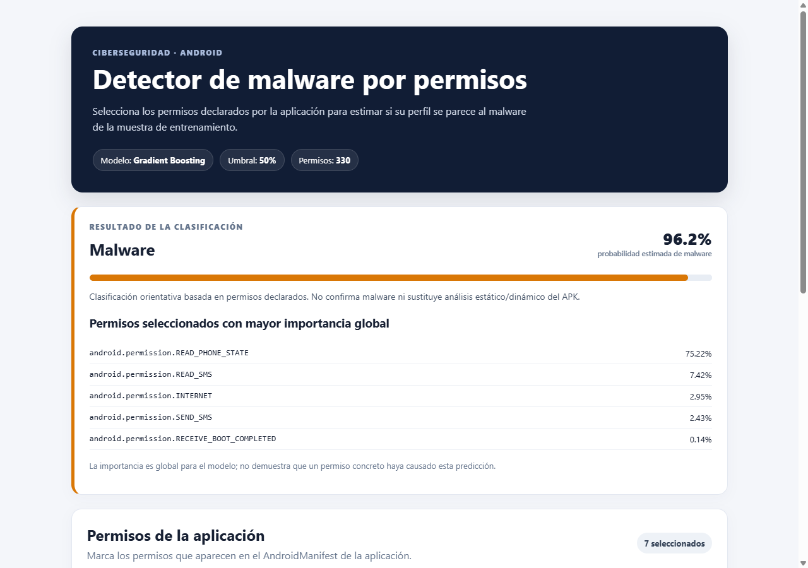
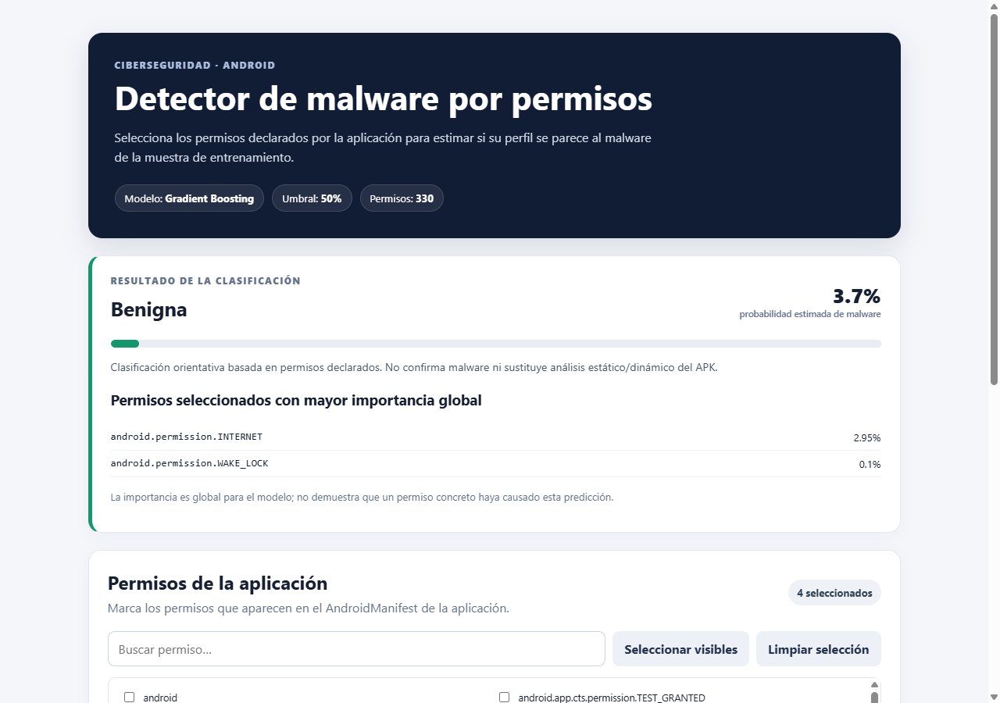

# 🛡️ DroidSentinel AI

**Detector de malware Android basado en permisos, con Machine Learning y Flask.**

Seleccionas los permisos que declara una app en su `AndroidManifest.xml` y DroidSentinel estima la probabilidad de que su perfil corresponda a malware. Funciona como interfaz web y como API REST JSON.

Proyecto académico de la Maestría en Inteligencia Artificial Aplicada (MIIA), Universidad Icesi, HACK-AI.

> 📊 **Dataset:** [*Dataset malware/beningn permissions Android*](https://www.kaggle.com/datasets/xwolf12/datasetandroidpermissions), de [**Christian Urcuqui**](https://www.kaggle.com/xwolf12) (Kaggle, 2016). Ver [Dataset y créditos](#dataset-y-créditos).

| App con permisos de SMS y teléfono → **Malware (96.2%)** | App con permisos comunes → **Benigna (3.7%)** |
|---|---|
|  |  |

**Stack:** Python · scikit-learn · pandas · Flask · Jinja2 · JavaScript

### Resultados (validación cruzada agrupada, 4 pliegues × 3 repeticiones)

| Modelo | F2 | Recall | Precisión | ROC-AUC |
|---|---|---|---|---|
| **Gradient Boosting (seleccionado)** | **0.9598** | **0.9745** | 0.9096 | 0.9756 |
| SVM RBF | 0.9375 | 0.9439 | 0.9201 | 0.9812 |
| Regresión logística | 0.9345 | 0.9354 | 0.9383 | 0.9752 |
| Extra Trees | 0.9227 | 0.9235 | 0.9276 | 0.9822 |
| Random Forest | 0.9223 | 0.9218 | 0.9334 | 0.9820 |
| Naive Bayes Bernoulli | 0.8897 | 0.8810 | 0.9400 | 0.9700 |

Se optimiza **F2** porque, en seguridad, dejar pasar malware (falso negativo) es más costoso que una falsa alarma. Detalles en `models/metadata.json`.

Otras características:

- Validación sin fuga de datos: los perfiles de permisos idénticos siempre caen en el mismo pliegue.
- Limpieza automática de perfiles con etiquetas contradictorias.
- Cabeceras de seguridad HTTP (CSP, `X-Frame-Options`, `nosniff`) y validación estricta de entradas.

## Dataset y créditos

Este proyecto usa el dataset **[Dataset malware/beningn permissions Android](https://www.kaggle.com/datasets/xwolf12/datasetandroidpermissions)**, creado y publicado por **Christian Urcuqui** ([@xwolf12 en Kaggle](https://www.kaggle.com/xwolf12)) como resultado de su investigación en machine learning y seguridad Android. Cada aplicación se representa como un vector binario de permisos (`1` = usado, `0` = no usado) con la etiqueta `type` (`1` = malware, `0` = benigna).

El archivo `train.csv` de este repositorio procede de esa publicación. Todos los derechos sobre el dataset pertenecen a su autor. El código de este repositorio es independiente del dataset.

Como solicita el autor, si usas este dataset en un trabajo, cita:

> Urcuqui, C., & Navarro, A. (2016, April). Machine learning classifiers for android malware analysis. In *Communications and Computing (COLCOM), 2016 IEEE Colombian Conference on* (pp. 1-6). IEEE.

Agradecimiento especial al profesor Christian Urcuqui, autor del dataset.

## 1. Requisitos

- Python 3.10 o superior.
- `pip`.

## 2. Instalación

En una terminal, desde esta carpeta:

```bash
python -m venv .venv
```

Activar el entorno:

```bash
# Windows PowerShell
.venv\Scripts\Activate.ps1

# Linux / macOS
source .venv/bin/activate
```

Instalar dependencias:

```bash
pip install -r requirements.txt
```

## 3. Entrenar el modelo

El CSV debe estar separado por punto y coma y contener la columna `type`:

```bash
python train_model.py --csv train.csv
```

El script compara Gradient Boosting, Regresión Logística, SVM RBF, Random Forest, Extra Trees y Naive Bayes Bernoulli. Selecciona el modelo con mejor F2 medio en validación cruzada estratificada y agrupada (4 pliegues, 3 repeticiones). Se usa F2 para priorizar el recall de malware. Los perfiles idénticos se mantienen en el mismo pliegue; si un perfil idéntico tiene etiquetas contradictorias, todas sus filas se excluyen del entrenamiento.

Se crean:

- `models/model.joblib`: pipeline entrenado y nombres de columnas.
- `models/metadata.json`: comparación de modelos y métricas de validación.

## 4. Ejecutar Flask

```bash
python app.py
```

Abrir en el navegador: <http://127.0.0.1:5000>

La pantalla permite buscar y seleccionar permisos, y luego muestra la clase y la probabilidad estimada de malware.

## 5. API JSON

`POST /api/predict`

Ejemplo:

```bash
curl -X POST http://127.0.0.1:5000/api/predict \
  -H "Content-Type: application/json" \
  -d '{"permissions":["android.permission.INTERNET","android.permission.READ_SMS"]}'
```

El campo `permissions` debe ser una lista de nombres que existan como columnas en `train.csv`. Un permiso ausente de la lista se codifica como 0.

## 6. Etiquetas y limitaciones

- `type = 1`: malware.
- `type = 0`: aplicación benigna/no malware.
- En los predictores, `1` representa permiso presente/utilizado en el vector del dataset y `0` representa ausente.

El sistema clasifica permisos declarados; **no analiza el APK ni demuestra que la aplicación haya accedido realmente a un recurso durante la ejecución**. Un resultado benigno no garantiza que una app sea segura y uno de malware no constituye una prueba forense. La muestra es pequeña y antigua; no se debe usar como antivirus ni como único control de seguridad.

Los artefactos de `joblib`/pickle solo deben cargarse si fueron generados por una fuente de confianza. Para un despliegue real, usar un servidor WSGI (por ejemplo, Gunicorn), HTTPS, autenticación y monitorización; no habilitar `debug=True`.
